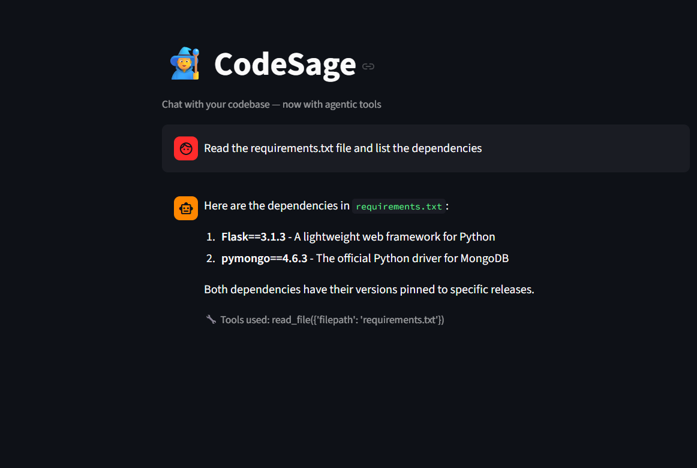

# 🧙 CodeSage — Chat With Your Own Codebase

CodeSage is an AI-powered assistant that lets you ask natural language questions about any codebase. It combines Retrieval-Augmented Generation (RAG) with agentic tool-calling, so it can either answer from indexed code context or actively read files/list the repo structure when needed.

## Features

- 🔍 **RAG-based retrieval** — indexes a codebase into a local vector database (ChromaDB) for semantic search
- 🤖 **Agentic tool-calling** — the AI can decide on its own to call tools like `list_files()` and `read_file()` to look up information beyond what's indexed
- 💬 **Chat interface** — built with Streamlit, includes chat history and visible "tools used" transparency
- 🆓 **Free to run** — uses Groq's free-tier API and a local embedding model, no cost to run

## How it works

1. **Ingestion** (`ingest.py`) — walks the target repo, reads code files, splits them into overlapping text chunks
2. **Embedding** (`embed.py`) — converts chunks into vector embeddings using a local SentenceTransformer model, stores them in ChromaDB
3. **Agent** (`app.py`) — when you ask a question, the AI either:
   - retrieves relevant chunks and answers directly, or
   - calls a tool (list files / read a specific file) if it needs more context than what's indexed

## Screenshot

   

## Setup

1. Clone this repo and navigate into it
2. Create a virtual environment: